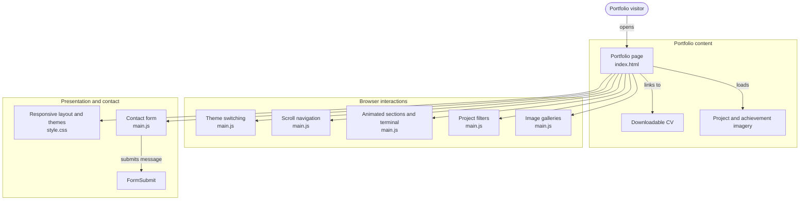

# Shaswata Barua | Portfolio

[](https://shaswatabarua.github.io)
[](#technology)

A responsive personal portfolio for **Shaswata Barua**, a Computer Science and Engineering student at BGC Trust University Bangladesh. The site brings together selected software and AI projects, robotics achievements, academic background, competitive programming, and research interests.

**Live portfolio:** [shaswatabarua-portfolio](https://shaswatabarua-portfolio-v1.vercel.app/)  
**Contact:** [shaswatabarua190@gmail.com](mailto:shaswatabarua190@gmail.com)

---

## Contents

- [Overview](#overview)
- [Features](#features)
- [Architecture](#architecture)
- [Technology](#technology)
- [Run locally](#run-locally)
- [Deploy with GitHub Pages](#deploy-with-github-pages)
- [Project structure](#project-structure)
- [Contact form](#contact-form)
- [Credits and use](#credits-and-use)

## Overview

This portfolio is a static, single-page website. It is designed to make project work and competition experience easy to browse on desktop and mobile. Visitors can switch themes, filter projects, open project and achievement images at full size, and contact the owner.

## Features

- Responsive layout with dark and light themes
- Project cards with category filters and links to source code and live demos
- Click-to-enlarge project posters and achievement images
- Interactive portfolio terminal and animated page sections
- Education, skills, experience, achievements, competitive programming, and research sections
- Downloadable CV
- Contact form connected to FormSubmit

## Architecture



## Technology

- **Structure:** HTML5
- **Presentation:** CSS3, responsive layouts, CSS custom properties
- **Interactions:** Vanilla JavaScript
- **Hosting:** GitHub Pages (static hosting)
- **Contact form:** FormSubmit
- **External fonts:** Google Fonts

No framework, package manager, or build process is required.

## Run locally

1. Clone or download this repository.
2. Open `index.html` in a browser.

For a local server, run a static server from the repository root, for example:

```bash
python -m http.server 8000
```

Then visit [http://localhost:8000](http://localhost:8000).

## Deploy with GitHub Pages

1. Create a public repository. For the URL `https://shaswatabarua.github.io`, name it `ShaswataBarua.github.io`.
2. Upload the contents of this project to the repository root. `index.html` must be at the root.
3. In the repository, open **Settings → Pages**.
4. Under **Build and deployment**, select **Deploy from a branch**.
5. Choose the `main` branch and `/(root)` folder, then save.
6. Wait for the deployment to finish. GitHub Pages will show the published address in the Pages settings.

The project can also be hosted on Netlify or Vercel as a static site. Set the project root as the publish directory and leave the build command empty.

## Project structure

```text
.
├── index.html
├── css/
│   └── style.css
├── js/
│   └── main.js
└── assets/
    ├── Shaswata_Barua_CV.pdf
    └── img/
        ├── profile.jpg
        ├── project-*.jpg
        ├── bgc-logo.png
        └── certificates and award images
```

- `index.html` contains page content, links, metadata, and image references.
- `css/style.css` contains layout, colors, typography, responsive rules, and theme styles.
- `js/main.js` powers themes, navigation, animations, project filters, galleries, terminal interactions, and the contact form.
- `assets/` contains the CV and images used by the page.

## Contact form

The form sends messages through FormSubmit to the portfolio email address. After the first deployment, send a test message and follow the activation link FormSubmit emails to the recipient. Form delivery depends on FormSubmit and an internet connection; visitors can also email the address directly.

## Credits and use

Created by **Shaswata Barua**. Project descriptions, personal details, photographs, posters, and certificate images belong to their respective owners. Please contact the owner before reusing personal content or imagery.
